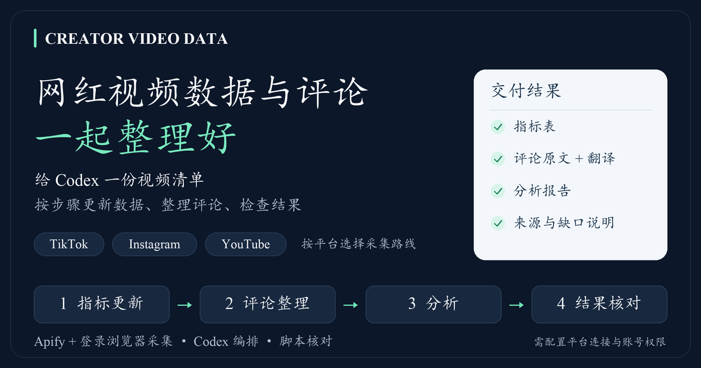
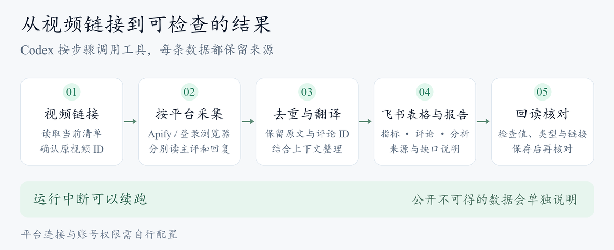

# Creator Video Data

## 把网红视频数据和评论整理好

[](LICENSE)
[](#安装和准备)

几十条合作视频，发在不同平台。播放量要更新，评论要收集，还要翻译、分析和填表。

这个 Codex skill 把这些工作按步骤安排好。你提供视频清单和参考模板，Codex 选择采集工具，整理数据，最后检查表格和报告。



Skill 可以理解为给 AI 的操作说明。它告诉 Codex 用哪些工具、遇到缺数据怎样处理，以及交付前检查什么。实际采集需要连接 Apify 或可用的浏览器；飞书写入需要相应权限。

## 能帮你做什么

| 工作 | 得到的结果 |
|---|---|
| 更新视频数据 | 按视频核对播放量、点赞、收藏、评论和分享等指标 |
| 收集评论和回复 | 保留原文、中英译文、回复关系及来源链接 |
| 分析观众反馈 | 区分观众在谈产品还是达人，再整理情绪、问题和关注点 |
| 整理飞书交付 | 按参考格式更新指标，或新建评论表及分析文档 |
| 检查结果 | 核对数值、日期、公式和可点击链接 |
| 中断后继续 | 检查已有任务和保存记录，从未完成的步骤接着做 |

适合做网红合作复盘、品牌营销报告，以及需要定期整理视频数据的团队。

## 怎么使用

安装后，把视频清单和模板发给 Codex，再说明这次要做什么。例如：

```text
用 $creator-video-data 处理这个 Deliverables 表。
全部刷新当前已发布视频的指标。
按我提供的评论表和分析文档，新建两份交付。
保留评论原文和来源，列明哪些数据无法取得。
写入后重新打开飞书，核对结果再交付。
```

只需要更新指标时，说明“这次只更新指标”。需要增量整理时，可以说明“保留旧记录，新增和有变化的评论单独标出来”。默认按完整刷新处理。



## 安装和准备

最省事的安装方式是把仓库链接发给 Codex：

```text
帮我安装这个 skill：
https://github.com/Hailellj/creator-video-data
```

也可以自己安装。macOS 或 Linux：

```bash
git clone https://github.com/Hailellj/creator-video-data.git ~/.codex/skills/creator-video-data
```

Windows PowerShell：

```powershell
git clone https://github.com/Hailellj/creator-video-data.git "$env:USERPROFILE\.codex\skills\creator-video-data"
```

已有同名目录时先保留备份，避免覆盖自己的修改。

运行实际任务前，准备好这些条件：

- 使用 Codex，或能读取 `SKILL.md` 的 AI 助手。
- 连接可用的 Apify MCP；部分平台也需要已登录浏览器。
- 提供有权限访问的视频清单、飞书表格和参考文档。
- 本地运行整理和检查脚本时，需要 Python 3.10 或以上。

四个 Python 工具只使用标准库，无需额外安装 Python 包。Skill 使用 MIT 许可证；Apify 的采集服务可能收费，取决于所选工具和账号套餐。

## 支持哪些平台

| 平台 | 使用说明 |
|---|---|
| TikTok | 有指标及评论采集路线，回复需要分页核对 |
| Instagram | 有指标采集路线；评论先确认工具配额和回复能力，必要时使用登录浏览器 |
| YouTube | 有指标及评论采集路线，缺少回复时可更换排序复核 |
| Facebook | 有 Reel 及评论采集路线，部分指标可能需要公开页面补充 |
| Snapchat | 区分 Spotlight 与 Story；原 Story 的后台数据通常需创作者提供 |
| X | 可读取帖子指标；非零回复的完整采集能力需要当次验证 |

收藏和分享等指标并非每个平台都公开。无法取得的数据会保留说明；确认是零的数据保留数字 `0`。

采集工具可能受配额、权限或分页限制。这个 skill 会记录缺口，避免把空结果直接当作“没有评论”。它不保证取得隐藏、已删除或非公开的内容。

## 先用示例体验

仓库带有三个平台的合成数据。示例地址和账号均为虚构，不代表真实合作内容。以下命令只处理本地文件，不启动线上采集，也不写飞书。

```bash
python3 scripts/audit_corpus.py \
  --inventory examples/inventory.json \
  --metrics examples/metrics.json \
  --comments examples/comments.json \
  --coverage examples/coverage.json \
  --required-metrics views likes saves comments shares \
  --expected-videos 3 \
  --output demo-output/audit.json
```

更多演练见 [示例说明](examples/README.md)。

## 仓库里有什么

| 文件 | 用途 |
|---|---|
| [SKILL.md](SKILL.md) | Codex 执行任务时读取的说明 |
| [workflow.py](scripts/workflow.py) | 生成本项目任务计划，保存运行记录并支持续跑 |
| [reconcile_comments.py](scripts/reconcile_comments.py) | 合并评论，保持编号，区分全量与增量 |
| [audit_corpus.py](scripts/audit_corpus.py) | 检查清单对应、漏字段、回复关系和数值类型 |
| [verify_delivery.py](scripts/verify_delivery.py) | 用保存的回读核对目标值、公式和真实链接 |
| [平台路线](references/platform-routes.md) | 采集工具选择及各平台的限制 |
| [数据格式](references/data-contract.md) | 脚本需要的输入字段 |
| [任务和工具用法](references/workflow.md) | 配置、命令及续跑步骤 |
| [飞书交付说明](references/feishu-delivery.md) | 写入与回读检查 |

Python 脚本负责本地整理和检查。真正的采集、翻译及飞书操作由 Codex 调用已连接的工具完成。检查本地文件通过后，仍需确认本次云端保存结果。

## 测试和反馈

```bash
python3 -m unittest discover -s tests -v
```

测试使用合成数据，检查评论编号、全量与增量、异常输入、回复关系、链接及任务续跑等行为。

遇到问题可以 [提交 Issue](https://github.com/Hailellj/creator-video-data/issues)。说明你使用的平台、操作步骤和错误信息；示例请用合成数据或脱敏数据，保留自己的凭据和私人链接。

欢迎补充已验证的平台路线，或改进测试。参与方式见 [CONTRIBUTING.md](CONTRIBUTING.md)。

项目由 [Hailellj](https://github.com/Hailellj) 维护，按 [MIT License](LICENSE) 开源。
